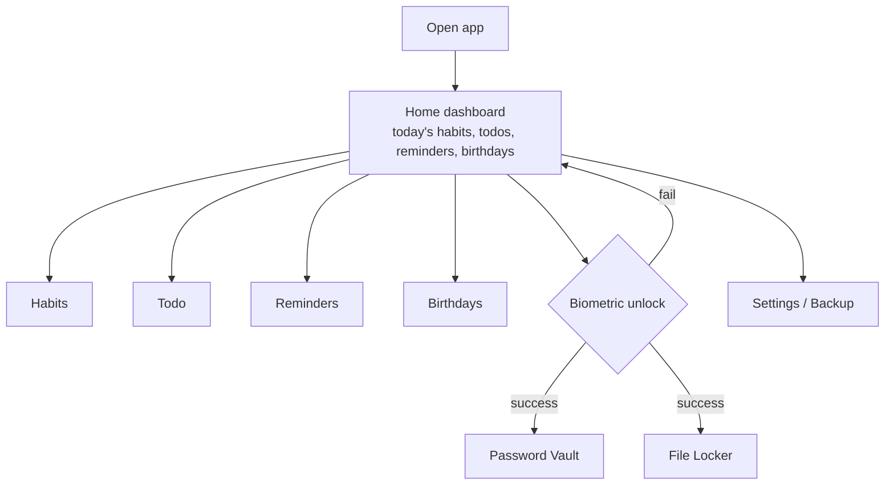
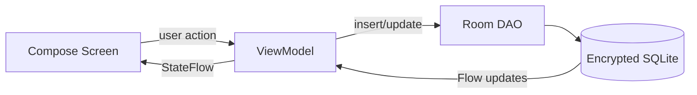
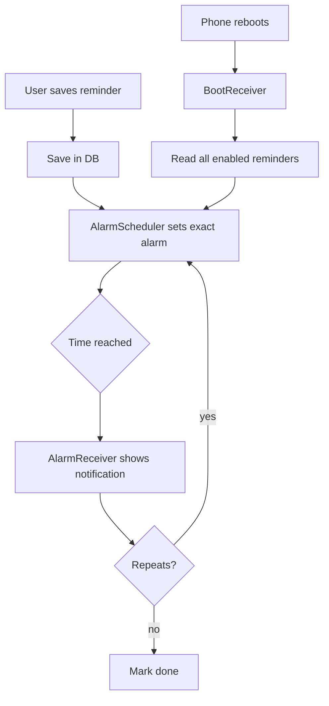
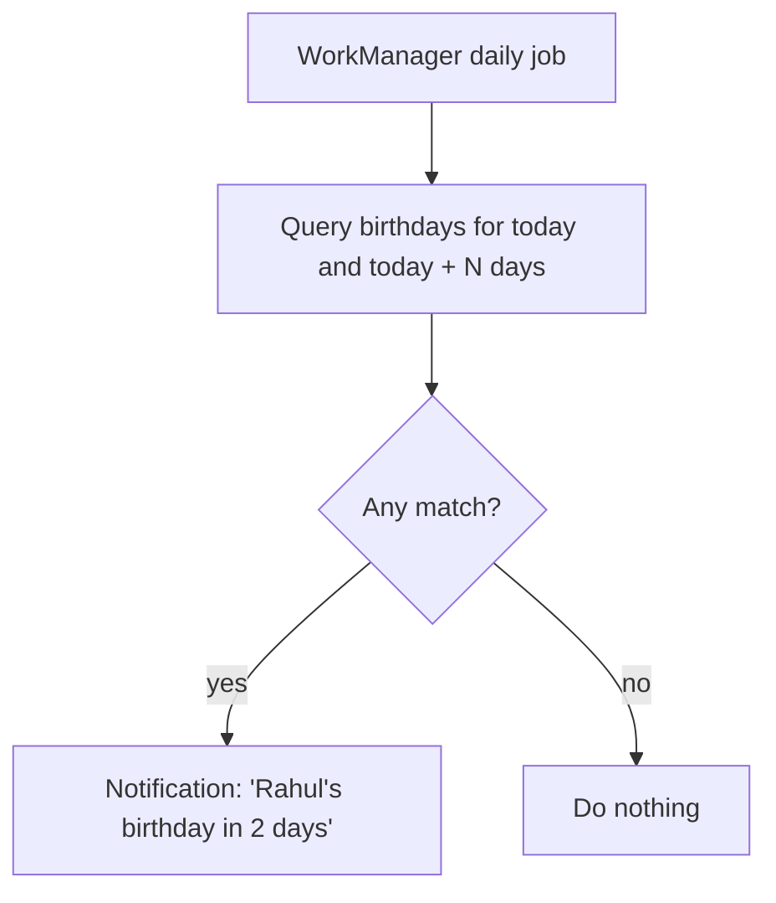
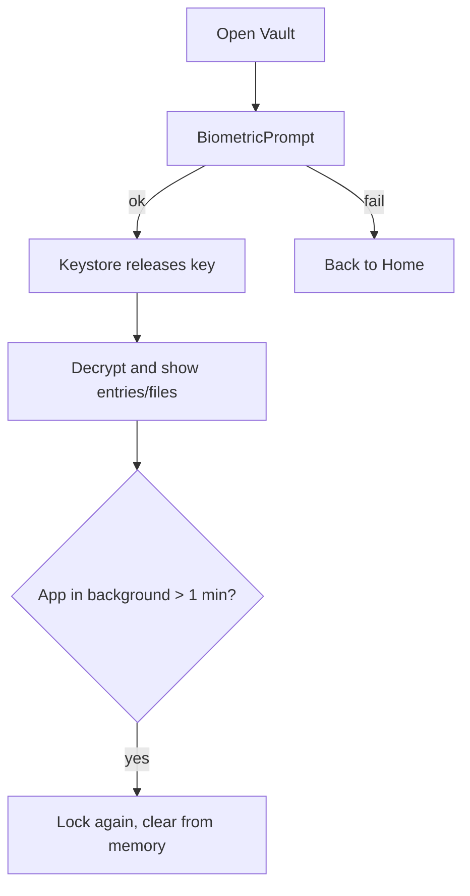
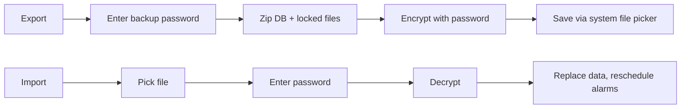

# Flowcharts

These are Mermaid diagrams. View them in VS Code with the "Markdown Preview Mermaid Support" extension, or on GitHub.

## 1. App structure

## 2. Data flow (every screen works like this)

## 3. Reminder / alarm lifecycle

## 4. Birthday check

## 5. Vault / Locker unlock

## 6. Backup

